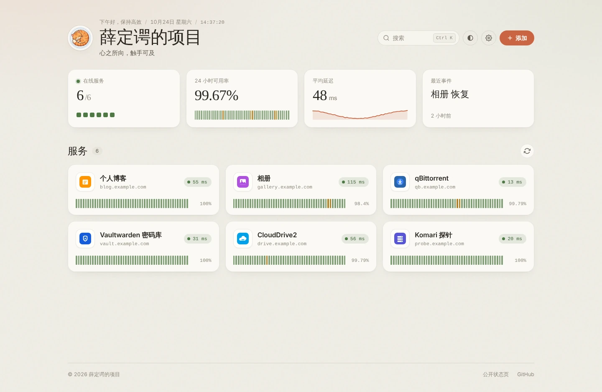
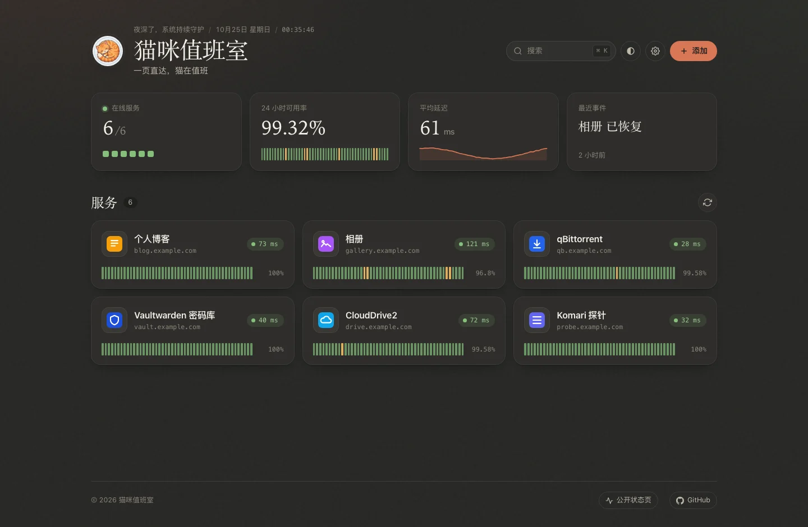
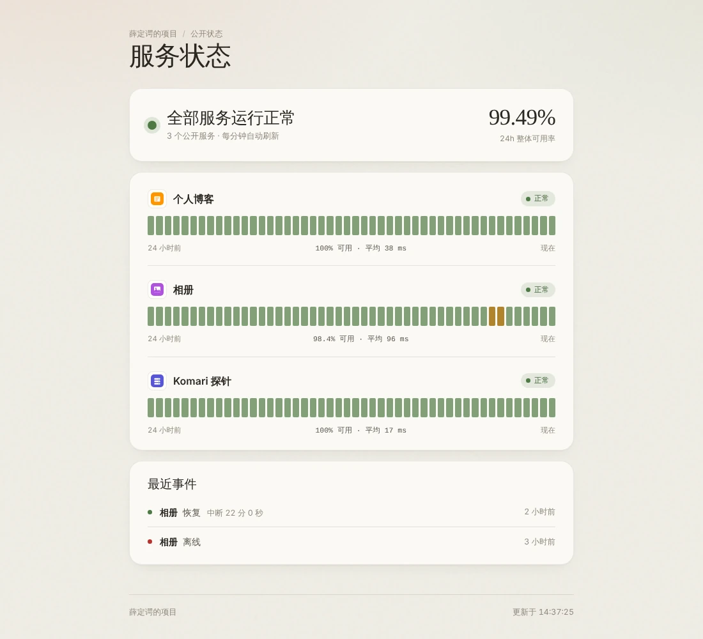
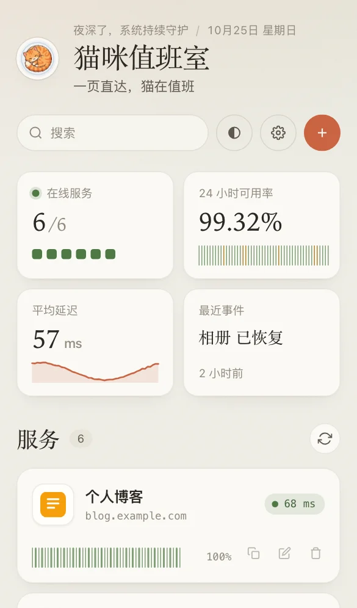

<div align="center">

# 🐱 猫咪值班室 (CatWatch)

**温暖的自托管导航页，顺便替你盯着每一个服务**

[](https://opensource.org/licenses/MIT)
[](https://nodejs.org)
[](https://www.docker.com/)

*一页直达，猫在值班。*

📖 **[在线文档与教程](https://uncat2310.github.io/catwatch/)** — 部署、配置、通知与公开状态页，一页看完

<br/>



<details>
<summary><b>深色模式 · 公开状态页 · 手机</b></summary>
<br/>



<table>
  <tr>
    <td width="62%"></td>
    <td width="38%"></td>
  </tr>
</table>

</details>

</div>

---

## 📖 简介

自建服务一多，地址记不住，挂了也不知道。那就请一只猫来值班：它把所有服务摆在一页上，每隔几秒挨个看一眼，谁掉线了就喊你。

**猫咪值班室**是一个轻量的个人服务器导航页：把常用服务聚合成一页，同时由服务端持续探测、记录 24 小时可用率，服务掉线或恢复时推送通知，还可以生成一个只读的公开状态页分享给朋友。

- **一个容器搞定**：Node.js + Vite + 原生 JavaScript，无数据库、无前端框架
- **数据都是文件**：服务列表是 `config/projects.json`，历史和图标缓存在 `data/` 目录
- **暖纸色界面**：奶油纸色 / 暖炭灰深色，衬线标题，手机上同样好用

---

## ✨ 功能一览

| | |
| :--- | :--- |
| 🧭 **导航** | 服务卡片自动获取图标；`Ctrl + K` / `⌘ K` 搜索、键盘直达；首屏由服务端预渲染 |
| 📊 **监控** | 后台每 12 秒探测一次；每个服务显示 24 小时可用率条（48 段 × 30 分钟）和延迟；概览卡片汇总在线数、整体可用率、延迟走势和最近事件；历史保留 7 天 |
| 🔔 **通知** | 连续 3 次失败才判定离线，恢复时附中断时长；支持 Telegram、Bark、Server酱、通用 Webhook |
| 🌐 **公开状态页** | `/status` 只展示你勾选公开的服务：名称、状态、可用率和事件，不暴露任何地址 |
| ☁️ **多设备同步** | 设置 `ADMIN_TOKEN` 后，页面上的增删改直接写回服务器，所有设备看到同一份列表 |
| 🖼️ **图标** | 服务端读取服务页面声明的图标并缓存，同源加载；也可以手动指定；拿不到时显示首字母头像 |

---

## 🚀 快速开始

### Docker（推荐）

```bash
mkdir -p catwatch/config catwatch/data && cd catwatch
sudo chown -R 1000:1000 config data     # 容器内以 node 用户 (uid 1000) 运行，需要写权限

docker run -d \
  --name catwatch \
  --restart unless-stopped \
  -p 3000:3000 \
  -e ADMIN_TOKEN="换成一串足够长的随机字符串" \
  -v "$PWD/config:/app/config" \
  -v "$PWD/data:/app/data" \
  ghcr.io/uncat2310/catwatch:latest
```

然后：

1. 打开 `http://你的服务器IP:3000`
2. 点右上角「添加」，第一次保存时输入上面的 `ADMIN_TOKEN`
3. 服务会写进 `config/projects.json`，几秒后出现图标和在线状态

> 随机口令可以用 `openssl rand -hex 24` 生成。不设置 `ADMIN_TOKEN` 也能用，但页面上的修改只会保存在当前浏览器（见[两种编辑模式](#-两种编辑模式)）。

### Docker Compose

```bash
git clone https://github.com/uncat2310/catwatch.git
cd catwatch
docker compose up -d
```

`docker-compose.yml` 里的 `ADMIN_TOKEN`、通知变量和 `volumes` 默认是注释掉的，按需取消注释即可。文件同时声明了 `image` 与 `build`：默认拉取 GHCR 镜像，也可以 `docker compose build` 自己构建。

### Node.js

要求 Node.js 18+。

```bash
npm ci
npm run build
ADMIN_TOKEN="你的口令" npm start
```

<details>
<summary>用 PM2 或 systemd 常驻</summary>

PM2：

```bash
npm install -g pm2
ADMIN_TOKEN="你的口令" pm2 start server.js --name "catwatch"
pm2 save
```

systemd（生产环境建议用独立的非 root 用户运行）：

```bash
sudo useradd --system --home /srv/catwatch --shell /usr/sbin/nologin catwatch
sudo chown -R catwatch:catwatch /srv/catwatch

cat >/etc/systemd/system/catwatch.service <<'EOF'
[Unit]
Description=CatWatch - Service Navigation and Health Probe
After=network.target

[Service]
Type=simple
User=catwatch
Group=catwatch
WorkingDirectory=/srv/catwatch
ExecStart=/usr/bin/node /srv/catwatch/server.js
Restart=always
RestartSec=5
Environment=PORT=3000
Environment=NODE_ENV=production
EnvironmentFile=-/etc/catwatch.env

[Install]
WantedBy=multi-user.target
EOF

# 口令和通知变量放在单独的文件里，权限设为仅 root 可读
echo 'ADMIN_TOKEN=你的口令' | sudo tee /etc/catwatch.env
sudo chmod 600 /etc/catwatch.env

systemctl daemon-reload
systemctl enable --now catwatch.service
journalctl -u catwatch -f
```

</details>

---

## ⚙️ 配置

### 服务列表 `config/projects.json`

大多数情况下直接在页面上增删改即可；也可以手工编辑这个文件（保存后自动生效，无需重启）。示例见 [`config/projects.example.json`](config/projects.example.json)：

```json
[
  {
    "id": "p-blog",
    "title": "个人博客",
    "customWanUrl": "https://blog.example.com",
    "pingEnabled": true,
    "statusPublic": true
  }
]
```

| 字段 | 必填 | 说明 |
| :--- | :--- | :--- |
| `id` | ✅ | 唯一标识，字母、数字、`-` `_` `.` `:` |
| `title` | ✅ | 显示名称 |
| `customWanUrl` | ✅ | 服务地址，`http://` 或 `https://`，可以是内网地址 |
| `pingEnabled` | | 是否探测在线状态，默认 `true` |
| `statusPublic` | | 是否出现在公开状态页，默认 `false` |
| `iconUrl` | | 手动指定图标地址；留空则自动获取 |

`config/projects.json` 已被 `.gitignore` / `.dockerignore` 忽略，可以放心写内网地址。文件不存在时显示内置的公开示例。

### 环境变量

| 变量 | 默认 | 说明 |
| :--- | :--- | :--- |
| `PORT` | `3000` | 监听端口 |
| `ADMIN_TOKEN` | 空 | 管理口令。设置后页面上的修改写回服务器；请使用足够长的随机字符串 |
| `DATA_DIR` | `./data` | 探测历史 `history.json` 与图标缓存 `icons/` 的目录 |
| `TELEGRAM_BOT_TOKEN` / `TELEGRAM_CHAT_ID` | 空 | Telegram 通知，两者都要填 |
| `BARK_URL` | 空 | Bark 通知，如 `https://api.day.app/<key>` |
| `SERVERCHAN_SENDKEY` | 空 | Server酱 Turbo 通知 |
| `NOTIFY_WEBHOOK_URL` | 空 | 通用 Webhook，POST JSON：`{ title, body, event }` |
| `ALLOW_INSECURE_TLS` | `false` | 为 `true` 时探测和取图标忽略证书错误（自签证书的内网服务） |
| `TRUST_PROXY` | `false` | 仅当服务位于**可信反向代理**之后、且后端端口不对公网暴露时才设为 `true`，用于信任 `X-Forwarded-For` |
| `CORS_ORIGIN` | 空 | 默认只允许同源；需要跨域时显式设置 |

---

## ☁️ 两种编辑模式

| | 服务器模式（设置了 `ADMIN_TOKEN`） | 本地模式（未设置） |
| :--- | :--- | :--- |
| 服务列表来源 | `config/projects.json` | `config/projects.json` 作为初始值，之后以浏览器为准 |
| 页面上增删改 | 首次输入管理口令后，写回 `config/projects.json` | 只保存在当前浏览器 |
| 多设备同步 | ✅ | ❌ |
| 可用率历史 / 通知 / 公开状态页 | ✅ 全部服务 | 仅 `config/projects.json` 中的服务 |

- 管理口令保存在当前浏览器，可在「设置 → 服务器同步」中退出
- 从本地模式切换过来时，如果浏览器里还留着旧的本地列表，可以在「设置 → 服务器同步」里一键上传或丢弃
- 主题、标题、副标题这些个人偏好始终只保存在浏览器

---

## 🔔 状态通知

服务端每 12 秒探测一次启用了探针的服务：

- **连续 3 次失败**（约 36 秒）才判定为离线并通知，单次抖动不会打扰你
- 恢复后的第一次成功即发送恢复通知，附上中断时长
- 状态写入历史文件，重启后不会重复通知同一次故障

配置任意一个通知变量即可启用，多个可以同时使用。登录管理后，在「设置 → 服务器同步」里可以发送一条测试通知。

<details>
<summary>通用 Webhook 的请求格式</summary>

```json
{
  "title": "🔴 相册 不可用",
  "body": "https://gallery.example.com/\n原因：TIMEOUT",
  "event": {
    "id": "p-gallery",
    "title": "相册",
    "url": "https://gallery.example.com/",
    "type": "down",
    "at": 1792846872154,
    "error": "TIMEOUT"
  }
}
```

恢复事件的 `type` 为 `up`，并带 `durationMs`（中断时长，毫秒）。

</details>

---

## 🌐 公开状态页

访问 `https://你的域名/status` 即可看到只读的状态页：整体状态、24 小时整体可用率、每个服务的状态条，以及最近的掉线 / 恢复事件。

- 只显示勾选了「在公开状态页显示」的服务（编辑弹窗中设置，或在 `projects.json` 中写 `"statusPublic": true`）
- **不包含**任何服务地址、hostname、内部 ID 或错误码；图标通过不含 ID 的匿名地址加载
- 服务端预渲染，禁用 JS 也能看，每分钟自动刷新

如果主页本身放在密码后面，可以只放行状态页需要的路径。Caddy 示例：

```caddy
portal.example.com {
    @public path /status /api/status /api/status-icon/* /assets/* /favicon.svg
    handle @public {
        reverse_proxy 127.0.0.1:3000
    }
    handle {
        basic_auth {
            admin <caddy hash-password 生成的哈希>
        }
        reverse_proxy 127.0.0.1:3000
    }
}
```

---

## 🖼️ 服务图标

图标由**服务端**获取并缓存，浏览器统一从同源的 `/api/icon/<服务ID>` 加载，按以下顺序尝试：

1. 编辑服务时填写的「图标地址」
2. 服务首页 HTML 中声明的 `<link rel="icon">` / `apple-touch-icon`（SVG 和高分辨率优先）
3. 站点根目录的 `/favicon.ico`
4. 都拿不到时显示首字母头像，颜色由服务名称决定

- 按文件头确认确实是图片，被重定向到登录页时返回的 HTML 不会被当成图标
- 缓存在 `DATA_DIR/icons/`，24 小时刷新一次；源站暂时不可用时继续使用旧图标
- 不经过任何第三方图标服务；HTTPS 门户下的 HTTP 服务也能正常显示图标
- 只保存在浏览器里的服务（本地模式下添加的）由浏览器直接加载手动图标地址或站点 `/favicon.ico`

---

## 🔄 升级

```bash
docker pull ghcr.io/uncat2310/catwatch:latest
docker stop catwatch && docker rm catwatch
# 再执行一遍「快速开始」里的 docker run（保持同样的 -e 和 -v 参数）
```

Compose：

```bash
docker compose pull && docker compose up -d
```

> **从旧版本升级**：旧版 README 推荐只读挂载单个 `projects.json`。这种挂载方式仍能运行，但页面上的保存会失败，历史和图标缓存也会在重启后丢失。请改为可写挂载 `config` 和 `data` 两个目录（见[快速开始](#docker推荐)），并把宿主目录属主改为 `1000:1000`。

---

## 🔐 安全建议

- 对外提供服务时请走 **HTTPS** 反向代理：管理口令通过请求头发送，明文 HTTP 下可能被窃听
- `ADMIN_TOKEN` 使用足够长的随机字符串（少于 12 个字符时启动日志会提示）；管理接口带限流
- 不要把 `config/projects.json`、`.env`、口令和通知密钥提交到公开仓库
- 探测和取图标允许访问你在 `projects.json` 里配置的内网地址；浏览器提交的任意地址则会拒绝 localhost / 私网 / 云 metadata 等目标（防 SSRF）
- 服务返回的 SVG 图标带沙箱 CSP 输出，不能在本站执行脚本

<details>
<summary>反向代理示例（Caddy / Nginx）</summary>

```caddy
portal.example.com {
    reverse_proxy 127.0.0.1:3000
}
```

```nginx
server {
    listen 80;
    server_name portal.example.com;

    location / {
        proxy_pass http://127.0.0.1:3000;
        proxy_http_version 1.1;
        proxy_set_header Host $host;
        proxy_set_header X-Real-IP $remote_addr;
        proxy_set_header X-Forwarded-For $proxy_add_x_forwarded_for;
        proxy_set_header X-Forwarded-Proto $scheme;
    }
}
```

</details>

---

## 🧩 API

| 方法 | 路径 | 鉴权 | 说明 |
| :--- | :--- | :--- | :--- |
| `GET` | `/api/info` | | 运行状态、是否启用管理 |
| `GET` | `/api/ping-all` | | 各服务最近一次探测结果 |
| `GET` | `/api/history` | | 各服务 24h / 7d 可用率、48 段历史、最近事件 |
| `GET` | `/api/icon/:id` | | 服务图标 |
| `GET` | `/api/status` | | 公开状态页数据（仅公开服务，不含地址） |
| `GET` | `/api/status-icon/:key` | | 公开状态页图标 |
| `POST` | `/api/auth` | 🔑 | 校验管理口令 |
| `PUT` | `/api/projects` | 🔑 | 整体替换服务列表，body：`{ "projects": [...] }` |
| `POST` | `/api/notify/test` | 🔑 | 发送测试通知 |

🔑 = 需要请求头 `Authorization: Bearer <ADMIN_TOKEN>`。

---

## 🛠️ 开发

```bash
npm ci
npm run dev      # Vite 开发服务器（无服务端预渲染与 API）
npm run check    # 构建 + 单元测试
npm run build && npm start   # 完整运行
```

```text
catwatch/
├── index.html / status.html     # 主页 / 公开状态页
├── server.js                    # 静态服务 + 服务端预渲染 + API + 后台探测
├── lib/                         # 服务端模块
│   ├── history.js               #   探测历史与状态机
│   ├── notify.js                #   通知通道
│   ├── icons.js / fetch.js      #   图标获取与受限 HTTP 请求
│   └── store.js                 #   配置校验、原子写入、口令比对
├── shared/                      # 前后端共用：卡片 / 状态页模板、可用率条、转义、SSRF 校验等
├── src/                         # 前端：app.js、status.js、style.css
├── test/                        # node:test 单元测试
├── config/projects.example.json # 示例配置
├── public/                      # 头像、favicon、内置图标
└── docs/screenshots/            # README 截图
```

---

## ⌨️ 快捷键

| 快捷键 | 功能 |
| :--- | :--- |
| `Ctrl + K` / `⌘ K` | 打开搜索 |
| `↑` / `↓` | 在搜索结果中移动 |
| `Enter` | 打开所选服务 |
| `Esc` | 关闭弹窗 |

---

## 🤝 参与贡献

欢迎提交 Issue 与 Pull Request。提交前请运行 `npm run check`。

## 📄 开源许可证

本项目基于 [MIT License](LICENSE) 协议开源。
